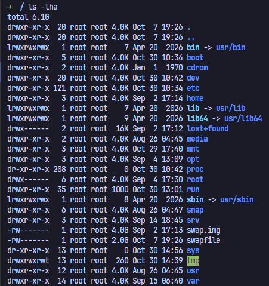

# Lab 01 - Filesystem Exploration 

## Objective 

Get a better understand of the linux FHS and my teorical studies 

## Environment 

- OS: CentOS 
- Virtual Machine 
- Shell: Bash 

## Exercises 

### 1 - Explore the root directory

Liste o conteúdo de `/` usando detalhes e arquivos ocultos. Identifique pelo menos 10 diretórios e explique a finalidade de cada um.

### 2 - Navigate through the filesystem

Acesse `/etc`, `/var/log`, `/home`, `/usr/bin` e `/tmp`. Em cada diretório, liste alguns arquivos e identifique o que eles representam.

### 3 - Find configuration files

Localize os arquivos `hostname`, `hosts` e `fstab`. Descubra para que cada um serve.

### 4 - Explore system binaries

Encontre os executáveis `ls`, `bash`, `grep` e `find`. Descubra em quais diretórios estão localizados.

### 5 - Investigate symbolic links

Descubra se /bin, /sbin e /lib são diretórios reais ou links simbólicos na sua distribuição.

### 6 - Explore virtual filesystems

Investigue /proc, /sys e /run.

### 7 - Investigate system logs

Explore /var/log e identifique quais arquivos registram eventos do sistema.

### 8 - Analyze disk usage

Descubra quais diretórios ocupam mais espaço no sistema.

### Challenge - Create a custom application structure

Imagine que você precisa preparar a estrutura de diretórios para uma aplicação chamada linuxops-app.