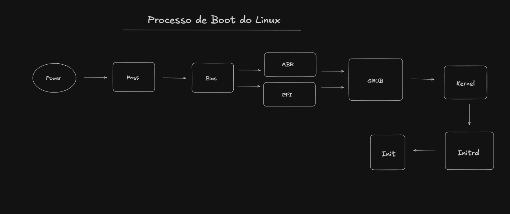

# Linux Boot Process

   The Linux boot process is the sequence of operations performed by a computer to initialize its hardware, load the Linux kernel, and start the operating system.

The process can be divided into the following stages:

## 2. Boot Stages

### 2.1 Power On

When the power button is pressed, the power supply provides electrical power to the computer's components.

The CPU begins executing instructions from the motherboard's firmware.

### 2.2 POST (Power-On Self-Test)

POST is a diagnostic process performed by the firmware to check and initialize essential hardware components.

Examples:

- RAM

- CPU

- Keyboard

- Storage devices

- Other essential hardware

If a critical problem is detected, the system may display an error or emit beep codes.

### 2.3 BIOS / UEFI

BIOS and UEFI are firmware interfaces responsible for initializing hardware and starting the boot process.

They identify available boot devices and follow the configured boot order.

#### BIOS (Legacy):

- Uses the traditional boot process.

- Commonly works with MBR partitioning.

- Loads the initial boot code from the boot device.

#### UEFI:

-  replacement for legacy BIOS.

- Usually works with GPT partitioning.

- Can load bootloaders from an EFI System Partition (ESP).

- Supports features such as Secure Boot.

`Important: MBR and GPT are partition table formats. BIOS and UEFI are firmware interfaces. They are related, but they are not the same thing.`

### 2.4 Bootloader (GRUB)

The bootloader is responsible for loading the operating system's kernel.

GRUB (GRand Unified Bootloader) is one of the most commonly used bootloaders in Linux distributions.

Its responsibilities include:

- Displaying the boot menu.

- Allowing the selection of different kernels.

- Passing boot parameters to the kernel.

- Loading the kernel and initramfs into memory.

### 2.5 Kernel

The Linux kernel is the core of the operating system.

It is responsible for:

- Managing CPU and memory.

- Controlling hardware.

- Managing processes.

- Handling device drivers.

- Managing filesystems.

- Providing system calls.

The kernel image is commonly named vmlinuz and is usually stored in /boot.

Example:

`ls -lh /boot`

### 2.6 Initramfs (Initial RAM Filesystem)

The initramfs is a temporary root filesystem loaded into memory during the boot process.

It contains tools, scripts and drivers required to prepare the real root filesystem.

Its responsibilities may include:

- Loading essential drivers.

- Detecting storage devices.

- Unlocking encrypted partitions.

- Activating LVM volumes.

- Finding and mounting the real root filesystem.

After the real root filesystem is ready, the system switches from the temporary environment to the actual root filesystem.

`Note: initrd and initramfs are related technologies. Modern Linux distributions commonly use initramfs.`

### 2.7 Init System (PID 1)

After the kernel initializes the system and mounts the root filesystem, it starts the first user-space process.

This process has PID 1.

On modern Linux distributions, this is usually systemd.

Its responsibilities include:

- Starting system services.

- Managing dependencies between services.

- Mounting filesystems.

- Managing system targets.

- Starting login services.

Useful commands:

`ps -p 1 -o pid,comm,args`

`systemctl list-units --type=service`

### GRUB Configuration 

GRUB configuration determines how the bootloader behaves.

The main configuration file is commonly:

`/boot/grub2/grub.cfg`

On some UEFI installations, the GRUB configuration may be stored in a different location. Check the distribution's layout before assuming the path.

**Best practice:** Avoid editing grub.cfg manually. It is usually generated automatically by configuration tools.

Common configuration sources include:

**RHEL / CentOS / Fedora** -> /etc/default/grub

**Ubuntu / Debian** -> /etc/default/grub

On many GRUB installations, scripts under /etc/grub.d/ are also used to generate the final configuration.

After changing GRUB settings, regenerate the configuration using the appropriate command for your distribution.

**RHEL-family systems:**

`sudo grub2-mkconfig -o /boot/grub2/grub.cfg`

**Ubuntu:**

`sudo update-grub`

### 4. What I Learned

- What are the differences between BIOS and UEFI?

 -> BIOS is a legacy firmware interface used to initialize hardware and start the boot process.
UEFI is its modern replacement. It supports additional features, provides a more flexible boot process, and commonly works with GPT partition tables instead of MBR.

- What is the purpose of the bootloader?

-> The bootloader is responsible for loading the operating system kernel and initramfs into memory, then passing the necessary boot parameters to the kernel.

- What is the role of initramfs?

-> Initramfs is a temporary filesystem loaded into memory during the boot process.
It provides the necessary tools and drivers to detect storage devices, initialize hardware, and prepare and mount the real root filesystem.

- Why does the kernel start PID 1?

-> PID 1 is the first user-space process started by the kernel.

It is responsible for initializing the user-space environment and starting other system processes and services.
On most modern Linux distributions, this process is systemd.

- What is the difference between init and systemd?

->init is the traditional initialization system used by older Unix and Linux systems. It typically starts processes and services using sequential scripts and runlevels.
systemd is a modern init system and service manager. It uses units to manage services, mounts, sockets, devices, and other system resources. It also supports parallel service startup and dependency management.
Both serve as PID 1 and are responsible for initializing the user-space environment.

- Why should grub.cfg not be edited manually?

-> grub.cfg is the main GRUB configuration file, but it is usually generated automatically by configuration tools.
Manual changes can be overwritten during system updates or when the configuration is regenerated. Incorrect modifications can also prevent the system from booting.
The recommended approach is to modify the appropriate configuration files, such as /etc/default/grub or scripts in /etc/grub.d/, and regenerate grub.cfg.
### 5. References

- The Linux Kernel Documentation -> https://docs.kernel.org/

- GNU GRUB Manual -> https://www.gnu.org/software/grub/manual/grub/

- systemd Documentation -> https://www.gnu.org/software/grub/manual/grub/

- Red Hat Enterprise Linux Documentation -> https://www.gnu.org/software/grub/manual/grub/