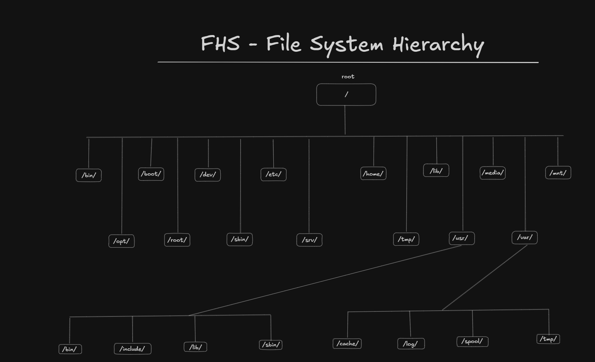

# Linux Filesystem Hierarchy

## Introduction

In Linux, the philosophy that "everything is a file" is fundamental to how the operating system works.

Regular files, directories, devices, and several system resources are represented through file-like interfaces. This makes it possible to interact with different system components using common tools and commands.

## FHS — Filesystem Hierarchy Standard

The **Filesystem Hierarchy Standard (FHS)** defines the directory structure and the recommended locations for files and directories in Linux systems.

Its purpose is to provide consistency between Linux distributions, making it easier for users, administrators, and software developers to understand where system files should be located.

Although many distributions follow the FHS, some implementation details may vary.

## Filesystem Hierarchy

### Root Directory — `/`

The root directory is the starting point of the entire filesystem hierarchy. Every other directory and file is located inside it.

Unlike Windows, which commonly uses separate drive letters such as `C:`, Linux organizes files under a single directory tree.

### Binary Directories — `/bin`

Contains essential command binaries required for basic system operation and recovery.

Examples include:

- `ls`
- `cp`
- `mv`
- `cat`

On many modern distributions, `/bin` is a symbolic link to `/usr/bin`.

### Boot — `/boot`

Contains the files required to boot the operating system.

Examples include:

- Linux kernel images
- GRUB bootloader files
- Initial RAM filesystem images (initramfs)

### Devices — `/dev`

Contains device files that provide interfaces to hardware devices and virtual devices managed by the kernel.

Examples:

- `/dev/sda` — a disk device.
- `/dev/tty` — a terminal device.
- `/dev/null` — a special device that discards written data.

These files allow programs to interact with devices through standard filesystem operations.

### Configuration Files — `/etc`

Contains system-wide configuration files and configuration directories for installed software.

Examples:

- `/etc/hostname`
- `/etc/hosts`
- `/etc/fstab`
- `/etc/ssh/sshd_config`

### Home Directories — `/home`

Contains the personal directories of regular users.

Each user typically has a directory named after their username.

For example:

`/home/john`

This directory usually stores personal files, downloads, documents, preferences, and user-specific application configurations.

The root user is an exception and has a separate home directory at `/root`.

### Libraries — `/lib`

Contains essential shared libraries required by system binaries, as well as other files needed for basic system operation.

On modern distributions, `/lib` may be a symbolic link to `/usr/lib`.

### Media — `/media`

Common mount point for removable media.

Examples include:

- USB flash drives
- External hard drives
- Memory cards
- Optical discs

Desktop environments often mount removable devices automatically under this directory.

### Mount — `/mnt`

Common mount point for temporarily mounted filesystems.

System administrators frequently use this directory when manually mounting disks, partitions, or remote filesystems.

### Optional — `/opt`

Used for installing optional or third-party software packages that are not part of the standard system installation.

Applications installed here may have their own directory structure.

Example:

`/opt/application-name`

### Root Home — `/root`

The home directory of the superuser (root).

It is separate from `/home` and is intended for files and configurations belonging to the root account.

### System Binaries — `/sbin`

Contains system administration and system maintenance binaries.

Examples include:

- `fsck`
- `reboot`
- `ip`

On modern distributions, `/sbin` may be a symbolic link to `/usr/sbin`.

These commands are not necessarily restricted to the root user, although many require administrative privileges.

### Service Data — `/srv`

Contains site-specific data served by the system.

Examples may include:

- Web server content
- FTP data
- Other service-related files

Its actual usage depends on the system administrator and the applications installed.

### Temporary Files — `/tmp`

Used to store temporary files created by applications and users.

Files in this directory may be removed automatically according to system cleanup policies. Some distributions clean it during boot, while others use different cleanup schedules.

### User Programs and Data — `/usr`

Contains most user-space applications, libraries, documentation, and shared resources.

It is one of the largest directories in a typical Linux installation.

Despite its name, `/usr` does not represent the home directory of regular users.

### User Binaries — `/usr/bin`

Contains most user commands and executable programs available on the system.

Examples include:

- `git`
- `python3`
- `grep`
- `find`

On modern distributions, this directory may also contain binaries traditionally associated with `/bin`.

### Header Files — `/usr/include`

Contains header files used primarily by C and C++ development tools.

These files provide declarations and interfaces required when compiling software.

### User Libraries — `/usr/lib`

Contains libraries and supporting files used by applications and system components.

Unlike `/lib`, it generally contains libraries that are not required for the earliest stages of system boot.

### Variable Data — `/var`

Contains data that changes during normal system operation.

Examples include logs, caches, application data, mail queues, and print queues.

### Log Files — `/var/log`

Stores system and application log files.

Examples:

- Authentication logs
- System logs
- Application logs
- Service logs

These files are useful for troubleshooting and monitoring system activity.

### Cache — `/var/cache`

Contains cached data generated by applications and system services.

Cached data can often be regenerated when needed.

### Spool — `/var/spool`

Contains data waiting to be processed by services or applications.

Examples include:

- Print queues
- Mail queues
- Scheduled jobs waiting for execution

## Additional Important Directories

### Process Information — `/proc`

A virtual filesystem that exposes information about running processes and kernel resources.

Examples:

- `/proc/cpuinfo`
- `/proc/meminfo`
- `/proc/uptime`

Most of its contents are generated dynamically by the kernel rather than stored as regular files on disk.

### System Information — `/sys`

A virtual filesystem that exposes information about devices, drivers, and kernel subsystems.

It provides an interface for inspecting and managing certain kernel and hardware attributes.

### Runtime Data — `/run`

Stores volatile runtime data created after the system starts.

Examples include:

- Process ID files (PID files)
- Socket files
- Runtime information used by system services

Its contents are generally cleared during reboot.

### Local Software — `/usr/local`

Used for software installed locally by the system administrator, rather than through the distribution's package manager.

Common subdirectories include:

- `/usr/local/bin`
- `/usr/local/lib`
- `/usr/local/share`

## What I Learned

Through this study, I gained a better understanding of the Linux filesystem hierarchy and the purpose of its main directories.

I learned where system configuration files, executable binaries, shared libraries, user data, logs, and temporary files are typically stored.

Understanding this structure makes navigating Linux systems easier and helps me troubleshoot problems, manage services, and understand how applications interact with the operating system.

## References

- **Linux Professional Institute (LPI):** [Linux Filesystem Hierarchy](https://learning.lpi.org/pt/learning-materials/101-500/104/104.7/104.7_01/)
- **Filesystem Hierarchy Standard:** [FHS Specification](https://refspecs.linuxfoundation.org/FHS_3.0/fhs/index.html)
- **Linux Training:** Formação Linux Completa — Mateus Muller ([Udemy](https://www.udemy.com/course/formacao-linux-completa-do-basico-ao-avancado/))